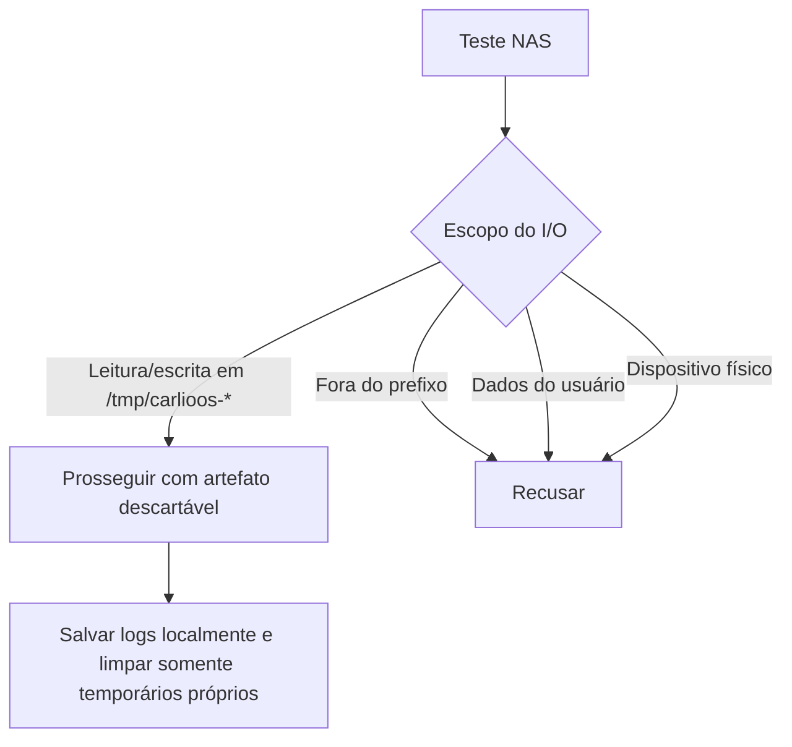
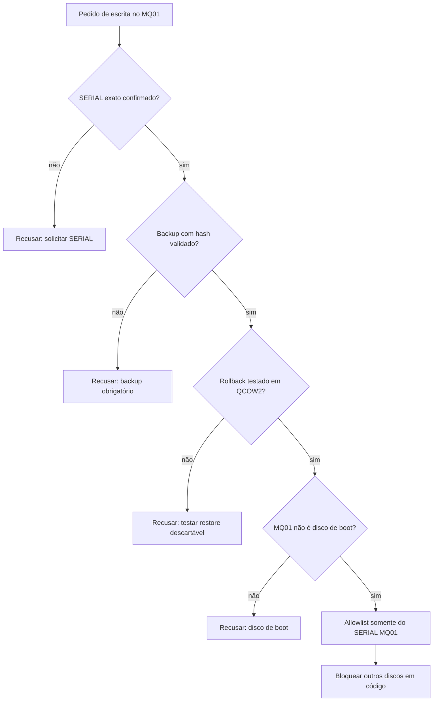
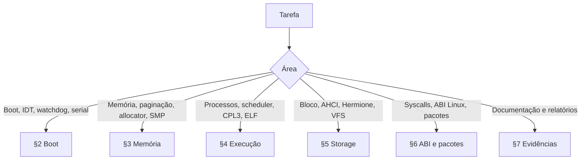
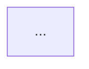

# Contrato operacional do CarlioOS

Este documento define o fluxo obrigatório para planejar, alterar, validar e
registrar trabalho no CarlioOS. Nenhuma função pode ser declarada funcionando,
implementada ou suportada além das evidências anexadas.

## §0. Princípios

- Kernel e componentes próprios em Rust; alvo x86-64 ponta a ponta.
- Mensagens visíveis no boot, kernel e terminal em português do Brasil (`pt_BR`).
- Endereços e tamanhos não podem ser truncados. Conversões estreitas usam
  `try_into()` e validação de faixa/overflow; `as` cru é proibido.
- Nunca armazenar senhas ou chaves em código, logs, documentação ou argv.
- Esperas de hardware têm timeout finito. Saída serial é best-effort; falha de
  serial nunca bloqueia o kernel.
- `Result` tipado em drivers; nenhum `unwrap`, `expect` ou `panic!` em driver ou
  IRQ. Todo `unsafe` contém comentário justificando a invariante protegida.
- Lock não pode ser mantido durante I/O.
- Alterações existentes no workspace pertencem ao usuário: inspecionar
  `git status`, preservá-las e não incluí-las em commits desta tarefa.
- I/O de teste autorizado no NAS limita-se a arquivos temporários em
  `/tmp/carlioos-*`, acessados por `nas-manjaro` ou pelo alias cabeado
  `nas-manjaro-cabo`, selecionado com `CARLIO_TEST_SSH_TARGET`.
  Leitura de dados do usuário, I/O fora desse prefixo e acesso a dispositivos
  físicos continuam proibidos, exceto o gate MQ01 estritamente condicionado
  descrito abaixo. Inventário de drivers/dispositivos é read-only.

- Escrita no disco Toshiba MQ01 somente depois de confirmar o SERIAL exato,
  verificar backup com hash validado, testar rollback em QCOW2 descartável e
  confirmar que o MQ01 não é disco de boot. Sem qualquer uma dessas provas,
  recusar escrita. Todos os outros discos de dados do NAS ficam bloqueados em
  código; o alvo deve ser allowlist do SERIAL confirmado, nunca inferido de
  `/dev/sdX`.





## §1. Roteamento

Classificar antes de agir e carregar as referências aplicáveis de §11.



Antes de editar: ler `CORRECT.md`, `docs/ARQUITETURA-KERNEL.md`, `docs/ROADMAP.md`
e os documentos da área. Ler os relatórios e os logs que fundamentam o estado
que será alterado ou mencionado. Registrar o estado inicial do workspace e
preservar alterações alheias.

## §2. Boot, IDT, watchdog e serial

Gates, nesta ordem:

1. `cargo fmt --check`, `cargo clippy --all-targets -- -D warnings` e
   `cargo test --all-targets`.
2. `scripts/test-local-iso.sh`: QEMU BIOS e UEFI; anexar ambos os logs.
3. Build de diagnóstico com testes intencionais de `#UD`, panic, watchdog e
   double fault. Cada cenário deve ser identificado no log.
4. Conectividade NAS: `ssh -F ~/.ssh/config_lab nas-manjaro 'uname -a'`.
   Para a rota cabeada, use `nas-manjaro-cabo` e configure
   `CARLIO_TEST_SSH_TARGET=nas-manjaro-cabo` no script de teste.
   Auditar o script antes da execução. Arquivos de
   teste remotos podem ser criados, lidos e removidos somente sob
   `/tmp/carlioos-*`; capturas finais devem ser salvas localmente. Recusar acesso
   a dados do usuário, caminhos fora desse prefixo ou dispositivos físicos.

Boot só pode ser chamado de funcionando com logs BIOS e UEFI anexados. Timeout
de serial é finito, e falha de serial não pode bloquear o kernel.

## §3. Memória, paginação e SMP

- Teste host de conversão `u64`↔`u32` com `try_into()`; overflow deve ser
  rejeitado.
- QEMU `-m 5G` e `-m 32G`; testar alocação, escrita, leitura e liberação de um
  frame acima de 4 GiB.
- Shootdown xAPIC em quatro CPUs: confirmar 18 shootdowns com ACK.
- Executar BIOS/UEFI em NAS/KVM com todos os artefatos confinados a
  `/tmp/carlioos-*`; se isso não puder ser garantido, registrar gate NAS
  pendente e continuar localmente.
- Registrar evidência e atualizar `reports/fase-2-memoria-execucao.md`.

Invariantes: allocator cobre até 32 GiB; memória acima é ignorada e contabilizada.
`IrqSpinLock` protege scheduler, pool e heap. `SmpPageTableManager` serializa
map/unmap e exige `TlbShootdown` explícito. Swap só pode ser habilitado depois de
VM estável, bloco confiável e testes de falha.

## §4. Processos, scheduler, ELF e CPL3

- Host: parser ELF64, VMA e ownership de páginas; probes positivos e negativos.
- QEMU: probe CPL3 com CR3/RSP0; fault isolado seguido de encerramento e reaper;
  preempção de timer entre dois CR3; syscalls inválidas rejeitadas.
- NAS/KVM pode usar somente arquivos de teste sob `/tmp/carlioos-*`; se o escopo
  não puder ser garantido, registrar pendência.
- Scheduler SMP CPL3 concorrente nos APs continua gate aberto até teste positivo
  anexado.

Invariantes: nenhum syscall usa ponteiro sem validação de faixa e alinhamento.
`mmap`, `munmap` e `brk` integram VMA, ownership das folhas e page tables.
Falha de processo encerra e recolhe recursos sem corromper o kernel. Todo bloco
`unsafe` justifica em comentário a invariante que mantém.

## §5. Bloco, AHCI, Hermione e VFS

- Host: journal, flush, corrupção simples e dupla, scrub e recuperação
  determinística.
- QEMU local com `--features storage-test`: imagem RAW descartável de 16–20 MiB
  criada somente em `/tmp`. Confirmar IDENTIFY, WRITE/READ, COMRESET e remontagem.
- Induzir erro ATA e confirmar recuperação após COMRESET.
- Nunca executar `storage-test` em hardware físico; `dd` contra dispositivos
  físicos e leitura de dados do usuário são proibidos. No NAS, a criação de
  imagens QCOW2 descartáveis e demais I/O de teste é permitida somente dentro
  de `/tmp/carlioos-*`; nunca acessar `/dev/sd*` nem paths fora desse prefixo.
  Nunca reutilizar QCOW2 entre execuções.
- Auditar `scripts/test-ahci-qemu.py` antes do uso remoto para confirmar que a
  imagem e os logs ficam sob `/tmp/carlioos-*`; se não, registrar “NAS pendente”.
- Atualizar relatório da fase 2/3 e anexar logs host e QEMU local.

“Journal geral” só pode ser declarado depois de teste de corte de energia em
QEMU. Simulação host de falha em write/flush é evidência útil, mas não substitui
esse gate.

## §6. Syscalls, ABI Linux e pacotes

Syscalls exigem dispatcher e validação de ponteiros, com probe CPL3 positivo e
negativo. Não relaxar validação para mascarar `EFAULT`.

Para cada formato de pacote, registrar separadamente em `docs/MATRIZ-PACOTES.md`:

1. inspeção/reconhecimento de metadados;
2. instalação transacional;
3. execução do payload;
4. isolamento;
5. atualização e rollback.

Testar cada operação isoladamente antes de declará-la suportada. Scriptlets de
instalador exigem sandbox e política explícita. AUR exige sandbox de build
separado; extração não basta. Flatpak e Snap exigem isolamento real no kernel,
não apenas extração no FHS. Compatibilidade Arch não pode ser inferida apenas
de `.PKGINFO`.

## §7. Logs, relatórios e estado

- Salvar saídas de teste e logs seriais em `reports/logs/`, com nomes que
  identifiquem fase, área, data e tipo de teste.
- Atualizar `reports/fase-N.md` com `### Correção — <título> — <data>`, sintoma,
  causa, arquivos alterados, comando exato, resultado e links relativos para
  logs. Indicar estado de host, QEMU BIOS, QEMU UEFI, NAS e hardware físico.
- Atualizar a checklist da fase; marcar `- [x]` somente com link para log.
- Estado da fase não muda de “aberta” para “concluída” sem todos os gates.
- Atualizar `docs/ROADMAP.md` com justificativa e link de log quando o estado de
  subsistema mudar. Atualizar `docs/HARDWARE-BASE.md` para detecção/driver/
  validação física e `docs/MATRIZ-PACOTES.md` por operação, quando aplicável.
- Não declarar suporte no ROADMAP só por aprovação em QEMU. Recurso suportado
  exige evidência positiva, negativa e de falha, em QEMU e NAS, anexada em
  `reports/logs/` e referenciada no relatório. Se um gate NAS estiver pendente,
  manter o estado aberto e não declarar suporte.
- Não alterar documentos sem relação com a mudança.

## §8. Fluxo de documentação e commit

```mermaid
flowchart TD
  A[Alteração concluída] --> B[Anexar logs em reports/logs]
  B --> C[Atualizar relatório e checklist da fase]
  C --> D{Afetou estado declarado?}
  D -->|Roadmap| E[Atualizar ROADMAP com justificativa e link]
  D -->|Hardware| F[Atualizar matriz detectado/implementado/validado]
  D -->|Pacotes| G[Atualizar operação específica]
  D -->|Não| H[Não alterar documentos sem relação]
  E --> I[Revisar diff e checklist pré-commit]
  F --> I
  G --> I
  H --> I
  I --> J[Commit fix(area): descrição com links]
```

Fazer commit apenas dos arquivos desta tarefa. Se o workspace tiver alterações
preexistentes que não possam ser isoladas com segurança, não fazer commit e
informar o bloqueio.

## §9. Checklist pré-commit obrigatório

```markdown
- [ ] cargo fmt --check
- [ ] cargo clippy --all-targets -- -D warnings
- [ ] cargo test --all-targets (host)
- [ ] Teste NEGATIVO novo cobrindo a invariante alterada
- [ ] scripts/test-local-iso.sh (BIOS + UEFI)
- [ ] storage-test em imagem descartável local sob /tmp (se bloco)
- [ ] scripts/test-nas.sh OU “NAS pendente” + log; limitar I/O remoto a
      /tmp/carlioos-* e proibir dispositivos físicos/dados do usuário
- [ ] Logs anexados em reports/logs/
- [ ] reports/fase-N.md atualizado (sintoma + causa + comando + resultado + links)
- [ ] docs/ROADMAP.md / docs/HARDWARE-BASE.md / docs/MATRIZ-PACOTES.md se aplicável
- [ ] Nenhum segredo em código/log/doc/argv
- [ ] Nenhuma alegação “suportado” sem positivo + negativo + falha
- [ ] Mensagens novas em pt_BR
- [ ] Conversões u64↔u32 com try_into + validação (sem `as` cru)
- [ ] Nenhum unwrap/expect/panic em driver ou IRQ
- [ ] Commit: fix(<área>): <descrição>, corpo com links do relatório e logs
```

Para mudança exclusivamente documental, executar apenas verificações
pertinentes ao texto e registrar itens de código como não aplicáveis. Nunca
marcar item como concluído sem evidência.

## §10. Proibições absolutas e anti-padrões

- Não escrever em discos físicos, exceto no MQ01 depois dos quatro gates
  obrigatórios de §0. Não ler dados do usuário. I/O de teste NAS está autorizado
  somente em `/tmp/carlioos-*`; nenhum caminho remoto fora dele. `storage-test`
  nunca roda em hardware físico; não executar `dd` contra dispositivos físicos.
  Imagens locais de teste ficam em `/tmp` local. Outros discos de dados devem
  ser bloqueados em código.
- Não reutilizar QCOW2 entre execuções; não declarar “journal geral” sem corte
  de energia em QEMU.
- Não marcar checklist `[x]` sem log, nem fechar fase sem todos os gates.
- Não declarar boot funcionando sem logs BIOS e UEFI.
- Não declarar suporte no ROADMAP só por QEMU.
- Não salvar segredo em código, logs, documentação ou argv.
- Não aceitar downgrade de validação de ponteiros; propor teste adverso.
- Não permitir panic em driver não essencial; usar `Result` tipado.
- Não declarar suporte Arch somente por `.PKGINFO`; exigir matriz por operação.
- Não reexecutar teste NAS em loop após falha; registrar pendência e seguir
  localmente.

## §11. Referências obrigatórias

Antes de agir, carregar os documentos aplicáveis e consultar as evidências
referenciadas neles:

| Documento | Uso |
|---|---|
| `CORRECT.md` | Instruções base, gates e invariantes |
| `docs/ARQUITETURA-KERNEL.md` | Camadas, HAL e resiliência |
| `docs/ROADMAP.md` | Ordem de fases, gates e estado por subsistema |
| `docs/HARDWARE-BASE.md` | Matriz detectado / implementado / validado |
| `docs/HERMIONE.md` | Filesystem, formato v3 e testes |
| `docs/MATRIZ-PACOTES.md` | Estado por formato e operação |
| `docs/USERLAND.md` | VFS, permissões, FHS e console |
| `docs/REFERENCIA-LFS-12.md` | Limites da referência LFS |
| `docs/TESTE-FISICO.md` | Procedimento de boot físico, sem escrita em mídia |
| `reports/fase-*.md` | Evidências e checklists por fase |
| `reports/logs/` | Saídas e logs citados pelos relatórios |

## §12. Formato e comportamento das respostas

Cada resposta de trabalho segue este formato compacto:

````text
Contexto: <1 linha>
Decisão: <1 linha>
Fluxo:

Artefatos: <arquivos/logs>
Próximo gate: <qual e onde>
````

Classificar a tarefa (§1), incluir diagrama quando houver decisão, gate ou
estado, anexar o checklist pré-commit relevante (§9) e declarar explicitamente
o gate que falta e onde seu log será anexado. Manter até cinco tópicos de
contexto. Se o pedido violar uma regra, recusar com o anti-padrão correspondente
de §10 e oferecer a alternativa válida.
