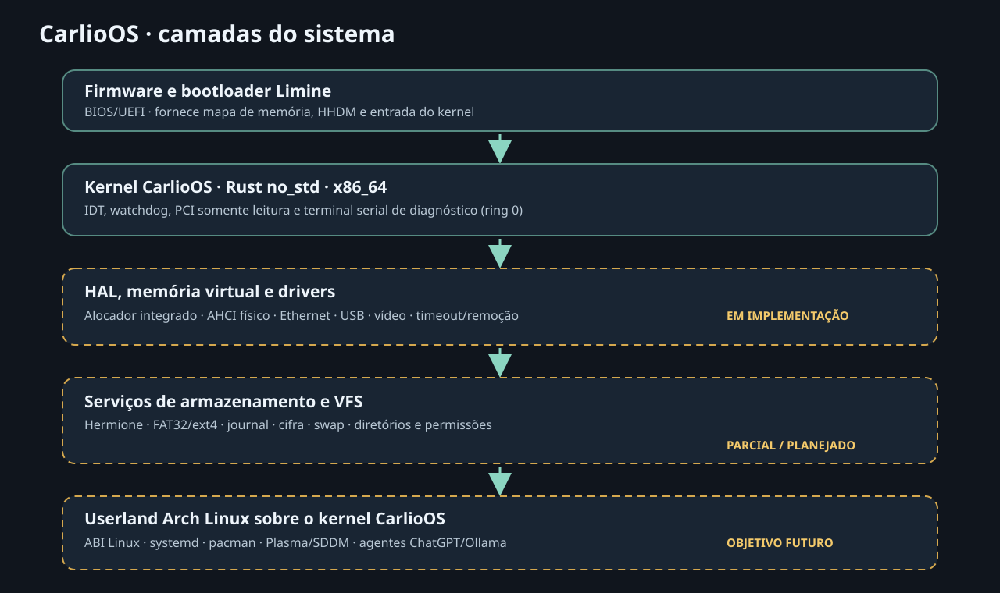
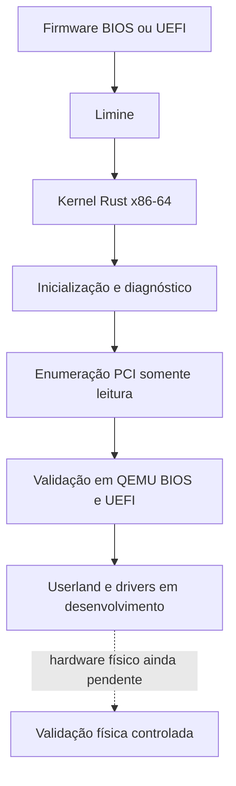
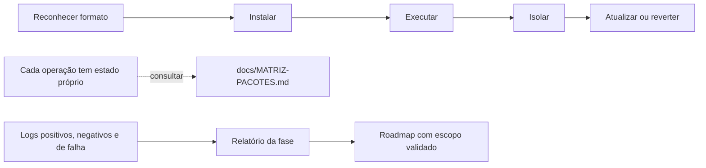

# CarlioOS

<p align="center">
  <a href="https://github.com/GabrielCazar/carlio-os/stargazers"></a>
  <a href="https://github.com/GabrielCazar/carlio-os/network/members"></a>
  <a href="https://github.com/GabrielCazar/carlio-os/issues"></a>
  
  
  
  <a href="LICENSE"></a>
</p>

<p align="center">
  <a href="https://github.com/GabrielCazar/carlio-os"></a>
  <a href="https://github.com/GabrielCazar"></a>
</p>

> **Estado:** protótipo experimental. Os badges e cartões mostram metadados do
> GitHub; não são evidência de que uma função do sistema esteja suportada.
> O CarlioOS é distribuído sob GNU GPL versão 3. Veja [LICENSE](LICENSE).

Sistema operacional experimental de 64 bits, escrito em Rust e direcionado a
x86_64. Kernel, processos e ABI têm como requisito operar em 64 bits. O desenvolvimento usa Arch Linux; o primeiro alvo executável é QEMU e,
depois, servidores físicos x86_64.

O objetivo é manter o kernel CarlioOS implementado em Rust e executar acima
dele a userland base do Arch Linux por compatibilidade Linux, com suporte
progressivo a DEB, RPM, EXE, AppImage, Flatpak/Flathub e Snap. O console será
zsh ou uma alternativa em Rust compatível com comandos/plugins selecionados.
A entrega será uma ISO beta inicializável
e instalável, validada em
QEMU e no hardware-alvo do NAS antes de qualquer uso como sistema base. O
instalador deverá proteger os discos existentes e exigir seleção/confirmacão
explícita do destino. Até lá, CarlioOS é experimental e não deve ser instalado
no NAS nem receber dados reais.

O idioma padrão do sistema é **português do Brasil (pt_BR)**: menu de boot,
mensagens do núcleo, terminal e interface. Comandos usam palavras sem acento
para facilitar a entrada em terminais seriais; as mensagens são UTF-8.
O splash serial e o comando `sobre` apresentam “carlIO OS | Criado por João G.R.Santos”.

## Fases

| Fase | Entrega | Estado |
| --- | --- | --- |
| 1. Contrato e hardware mínimo | Matriz de alvo, BIOS/UEFI, diagnóstico, PCI/AHCI mínimo | QEMU local e NAS/KVM BIOS/UEFI; 159 testes host; AHCI QEMU com recovery/COMRESET em imagem descartável. Drivers e boot físico seguem pendentes |
| 2. Memória e execução | Até 32 GiB de RAM, VM x86-64, kernel SMP, CPL3, ELF64 e processos | Allocator cobre até 32 GiB; há prova de CPL3/CR3 e testes host. Revalidação atual do smoke QEMU falha no probe de processos: 1 CPU não aplica afinidade e 4 CPUs dá #PF de kernel; isolamento não está validado |
| 3. Bloco e filesystems | BlockDevice, partições MBR/GPT e rootfs ext4/FAT32 | Aceite em VM concluído. BIOS/UEFI no NAS, 2 TiB, overlay persistente, replay nativo de metadados, timeout/COMRESET e retirada do disco SATA com o HBA presente. [Relatório](reports/fase-3-bloco-filesystems.md) |
| 4. VFS, contas e rede | Namespace FHS, mounts, permissões efetivas e serviços headless | Rootfs pode ser lido por VFS/syscalls e o smoke executa um ELF do ext4 por `execve`. Login serial com identidade POSIX e diagnóstico UDP validados em QEMU/KVM no NAS. Processos da sessão, DNS e sockets para aplicações, SSH/SFTP, SMB e rede física na Realtek RTL8111/8168 seguem pendentes |
| 5. ABI Linux e Arch | Runtime Linux progressivo, userland Arch e pacman/ALPM | ELF de teste em CPL3 e mmap privado de arquivos na fixture. A glibc real do Ubuntu ainda falha ao carregar |
| 6. Desktop e agentes | SDDM/Plasma, catálogo executável, ChatGPT/Ollama | Diagnóstico serial validado em VM no NAS. Plasma, SDDM e agentes seguem pendentes |
| 7. ISO beta instalável | Instalador seguro, diagnóstico, recuperação, atualização e validação NAS | Imagem virtual preparada com verificação SHA-256. Instalação e recuperação físicas no NAS seguem pendentes |
| 8. Programas Windows | PE/COFF e APIs Win32/NT | Validação PE32+ AMD64 e preparação de seções em memória. Execução de programas pendente |

Roadmap e critérios: [`docs/ROADMAP.md`](docs/ROADMAP.md). Há um relatório
Markdown para cada fase em [`reports/`](reports/). Painel: [`progress/index.html`](progress/index.html).
Hardware de referência local e do NAS: [`docs/HARDWARE-BASE.md`](docs/HARDWARE-BASE.md).
Camadas e contratos de segurança: [`docs/ARQUITETURA-KERNEL.md`](docs/ARQUITETURA-KERNEL.md).
Estrutura da userland e limites do login/apps: [`docs/USERLAND.md`](docs/USERLAND.md).
Matrizes de formato, operações e gates de pacotes:
[`docs/MATRIZ-PACOTES.md`](docs/MATRIZ-PACOTES.md).
Fluxogramas, imagens, manual e configuração: [`fluxogramas/README.md`](fluxogramas/README.md).
Procedimento e limites do [teste físico da ISO](docs/TESTE-FISICO.md).
Consulte os níveis do [Lockdown do kernel](docs/LOCKDOWN.md) e o procedimento para preparar a árvore UEFI.
Hermione e `herm-fs` estão arquivados como protótipo experimental; ext4 e FAT32
são os filesystems prioritários. Consulte o registro técnico preservado em
[`docs/HERMIONE.md`](docs/HERMIONE.md). O código e os testes de Hermione ficam
no repositório para referência, sem novos gates de produto.

`carlio-logs` agrega capturas `.log`/`.txt` em Markdown com tabela, gráficos
textuais e eventos relevantes; `carlio-logs ver <arquivo.md>` abre o
visualizador Rust paginado. No kernel, `logs` imprime a tabela Markdown do
buffer volátil de erros. O produto reserva 16 GiB do disco de sistema para logs
persistentemente armazenados (meta inicial: 1 GiB) e paginação (até 15 GiB);
swap permanece desativado até VM e bloco serem confiáveis.

## Arquitetura em uma imagem

O diagrama resume as camadas e marca os componentes experimentais e planejados.
Consulte também o [inventário de diagramas e manuais](fluxogramas/README.md).

<p align="center">
  
</p>

### Fluxo de inicialização



### Como ler o estado do projeto



Para armazenamento experimental, há diagramas separados do [fluxo de escrita
Hermione](fluxogramas/diagramas/hermione-gravacao.svg) e do [boot em modo
degradado](fluxogramas/diagramas/boot.svg). Esses desenhos não ampliam o estado
validado descrito nos relatórios e na matriz de pacotes.

## Segurança e limites do protótipo

O shell de diagnóstico executa em ring 0. Há execução CPL3 restrita e uma ABI
parcial, mas a revalidação QEMU atual falha no probe de processos; o isolamento
não deve ser considerado confiável. `openat` tem uma prova CPL3 histórica de
negação de arquivo `0600` com `EACCES`, sem enforcement geral. Rootfs ext4/FAT32
é montado em leitura, com copy-up limitado a 16 KiB por arquivo. O overlay
persiste em mídia dedicada `CARLIO-PERSIST-02`. As provas de escrita nativa,
recuperação e swap usam imagens de teste. O protótipo continua destinado
a imagens descartáveis.

O armazenamento persistente deverá ser desbloqueado antes da montagem, com
criptografia autenticada e chave apenas em memória. SQLite ficará acima do
filesystem e não guardará chaves. O bootloader permanece um componente externo
e a imagem de boot também precisará de uma cadeia de confiança.

## Construção e validação

No Arch Linux, dependências: `rust`, `rustup`, `qemu-system-x86`, `limine` e
`xorriso`. Para o kernel bare-metal é necessário o toolchain nightly com
`rust-src` e o alvo `x86_64-unknown-none`; os testes host rodam com stable.

```sh
cd carlio-os
cargo test --all-targets
cargo run --bin carlio-logs -- --help
cargo run --bin carlio-logs -- gerar reports/logs reports/logs/painel-validacao.md
RUSTUP_HOME=/tmp/carlio-rustup CARGO_HOME=/tmp/carlio-cargo rustup toolchain install nightly --component rust-src,rustfmt --target x86_64-unknown-none
RUSTUP_HOME=/tmp/carlio-rustup CARGO_HOME=/tmp/carlio-cargo rustup run nightly cargo build --release --bin carlio-kernel --target x86_64-unknown-none
./scripts/build-iso.sh
qemu-system-x86_64 -m 512M -cdrom build/carlio-os.iso -boot d -serial stdio -display none
scripts/test-local-iso.sh
./scripts/test-nas.sh
```

`scripts/test-local-iso.sh` roda os testes host, reconstrói a ISO e valida BIOS
e UEFI em QEMU local, salvando logs com timestamp em `reports/logs/`.

Comandos do terminal, em pt_BR: `ajuda`, `sobre`, `usuario`, `permissoes`,
`erros`, `logs`, `limpar`, `parar`. Toda alteração que afete comportamento deve passar pelos
testes locais aplicáveis e por `scripts/test-nas.sh`; o script valida BIOS e
UEFI no NAS/KVM. Resultados ficam em `reports/logs/`. O NAS Manjaro está
disponível pelos aliases SSH `nas-manjaro` (`192.168.50.10`) e
`nas-manjaro-wifi` (`192.168.3.143`), ambos para o usuário `gabriel`.
Em 24/11/2026, o acesso cabeado confirmou QEMU, OVMF e permissão de leitura e
escrita em `/dev/kvm`. O runner usa `nas-manjaro` por padrão e lê
`~/.ssh/config_lab` quando disponível. Use `CARLIO_TEST_SSH_CONFIG` e
`CARLIO_TEST_SSH_TARGET` para indicar outra configuração e destino.

O runner cria um QCOW2 esparso de 40 GiB por execução em `/tmp/carlioos-test-*`
e o anexa em modo snapshot. `CARLIO_TEST_VM_DISK` permite selecionar uma imagem
descartável preparada para o teste. Para validar somente QEMU/KVM com a ISO
construída na estação, execute `CARLIO_TEST_QEMU_ONLY=1 ./scripts/test-nas.sh`.
O modo completo também roda os testes Cargo no NAS e requer Rust nightly e
um compilador C. O NAS cabeado usa a instalação offline da conta `gabriel`
em `~/.local/share/carlioos-test/toolchain`, com Rust nightly, GCC e crates
vendorizados a partir do `Cargo.lock`. Ao alterar as dependências, atualize o
diretório `vendor` desse ambiente com `cargo vendor --locked`.
Para testar AHCI no limite de 2 TiB, gere a ISO com
`CARLIO_STORAGE_TEST=1 ./scripts/build-iso.sh` e execute:

```bash
CARLIO_TEST_STORAGE=1 CARLIO_TEST_STORAGE_2T=1 ./scripts/test-nas.sh
```

Para testar o overlay VFS persistente, crie uma imagem dedicada com
`python3 scripts/provision_storage.py --vfs --size-mib 16 overlay.raw` e
anexe-a ao AHCI virtual. O teste automatizado cria a própria imagem e
valida reinício e recuperação com
`python3 scripts/test-persistence-qemu.py --vfs --iso build/carlio-os.iso --log-dir /tmp/carlioos-overlay-logs`.
O teste usa uma ISO construída com `CARLIO_STORAGE_TEST=1`.

Durante o boot, o terminal
serial mantém uma barra de progresso numa linha fixa e registra as mensagens
de inicialização abaixo dela. O estado final indica que o shell ficou
disponível, não que os gates de VM/CPL3 passaram.

## Compatibilidade

Formatos de pacotes Linux não são, por si, compatibilidade de aplicações.
Executar seus programas requer ABI, syscalls, bibliotecas e sandbox. O Windows
Mode será uma VM Windows licenciada; não promete executar agentes proprietários
com Wine. Isso permite testar os agentes no sistema convidado para o qual foram
feitos.

## Licença

GNU General Public License versão 3.0 (GPL-3.0-only). Consulte [LICENSE](LICENSE)
para os termos completos. Componentes de terceiros mantêm suas licenças e avisos
próprios.
