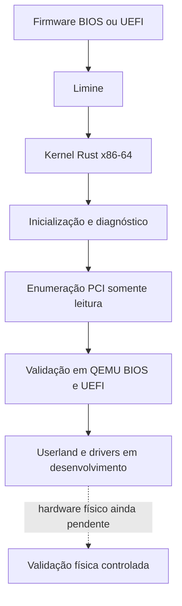
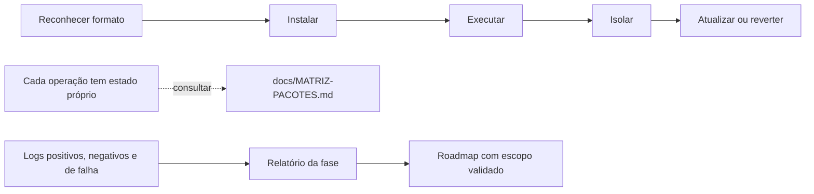

# CarlioOS

<p align="center">
  <a href="https://github.com/GabrielCazar/carlio-os/stargazers"></a>
  <a href="https://github.com/GabrielCazar/carlio-os/network/members"></a>
  <a href="https://github.com/GabrielCazar/carlio-os/issues"></a>
  
  
  
  <a href="LICENSE"></a>
</p>

<p align="center">
  <a href="https://github.com/GabrielCazar/carlio-os"></a>
  <a href="https://github.com/GabrielCazar"></a>
</p>

> **Estado:** protótipo experimental. Os badges e cartões mostram metadados do
> GitHub; não são evidência de que uma função do sistema esteja suportada.
> O CarlioOS é distribuído sob GNU GPL versão 3. Veja [LICENSE](LICENSE).

Sistema operacional experimental de 64 bits, escrito em Rust e direcionado a
x86_64. Kernel, processos e ABI têm como requisito operar em 64 bits. O desenvolvimento usa Arch Linux; o primeiro alvo executável é QEMU e,
depois, servidores físicos x86_64.

O objetivo é manter o kernel CarlioOS implementado em Rust e executar acima
dele a userland base do Arch Linux por compatibilidade Linux, com suporte
progressivo a DEB, RPM, EXE, AppImage, Flatpak/Flathub e Snap. O console será
zsh ou uma alternativa em Rust compatível com comandos/plugins selecionados.
A entrega será uma ISO beta inicializável
e instalável, validada em
QEMU e no hardware-alvo do NAS antes de qualquer uso como sistema base. O
instalador deverá proteger os discos existentes e exigir seleção/confirmacão
explícita do destino. Até lá, CarlioOS é experimental e não deve ser instalado
no NAS nem receber dados reais.

O idioma padrão do sistema é **português do Brasil (pt_BR)**: menu de boot,
mensagens do núcleo, terminal e interface. Comandos usam palavras sem acento
para facilitar a entrada em terminais seriais; as mensagens são UTF-8.
O splash serial e o comando `sobre` apresentam “carlIO OS | Criado por João G.R.Santos”.

## Fases

| Fase | Entrega | Estado |
| --- | --- | --- |
| 1. Contrato e hardware mínimo | Matriz de alvo, BIOS/UEFI, diagnóstico, PCI/AHCI mínimo | QEMU local e NAS/KVM BIOS/UEFI; 159 testes host; AHCI QEMU com recovery/COMRESET em imagem descartável. Drivers e boot físico seguem pendentes |
| 2. Memória e execução | Até 32 GiB de RAM, VM x86-64, kernel multithread/SMP, ring 3, ELF64 e processos | 32 GiB local e frames >4 GiB; KVM NAS validado a 5 GiB; ELF VFS de boot, preempção/fault/reaper BSP e shootdown xAPIC. Stress CPL3 nos APs, tabela dinâmica e ownership integral pendentes |
| 3. Bloco e filesystems | BlockDevice; descoberta MBR/GPT ext4/FAT32 no boot; ext4 principal e FAT32 para EFI/mídia removível | Leitores somente leitura e descoberta no boot; montagem no VFS/syscalls pendente; Hermione arquivado; hardware físico pendente |
| 4. VFS, contas e rede | Montagem, caminhos Linux, permissões efetivas, login e serviços headless | VFS POSIX/FHS e mounts host; NIC Intel 82574L QEMU com DHCP; identidade básica na ABI. Backends montados, enforcement integrado, login seguro, TCP/IP e serviços físicos pendentes |
| 5. ABI Linux e Arch | Runtime Linux progressivo, userland Arch e pacman/ALPM | Planejada; depende de processos e syscalls |
| 6. Desktop e agentes | SDDM/Plasma, catálogo executável, ChatGPT/Ollama | Planejada; não é gate inicial do NAS headless |
| 7. ISO beta instalável | Instalador seguro, diagnóstico, recuperação, atualização e validação NAS | Planejada; entrega final após os gates anteriores |

Roadmap e critérios: [`docs/ROADMAP.md`](docs/ROADMAP.md). Há um relatório
Markdown para cada fase em [`reports/`](reports/). Painel: [`progress/index.html`](progress/index.html).
Hardware de referência local e do NAS: [`docs/HARDWARE-BASE.md`](docs/HARDWARE-BASE.md).
Camadas e contratos de segurança: [`docs/ARQUITETURA-KERNEL.md`](docs/ARQUITETURA-KERNEL.md).
Estrutura da userland e limites do login/apps: [`docs/USERLAND.md`](docs/USERLAND.md).
Matrizes de formato, operações e gates de pacotes:
[`docs/MATRIZ-PACOTES.md`](docs/MATRIZ-PACOTES.md).
Fluxogramas, imagens, manual e configuração: [`fluxogramas/README.md`](fluxogramas/README.md).
Procedimento e limites do [teste físico da ISO](docs/TESTE-FISICO.md).
Hermione e `herm-fs` estão arquivados como protótipo experimental; ext4 e FAT32
são os filesystems prioritários. Consulte o registro técnico preservado em
[`docs/HERMIONE.md`](docs/HERMIONE.md). O código e os testes de Hermione ficam
no repositório para referência, sem novos gates de produto.

`carlio-logs` agrega capturas `.log`/`.txt` em Markdown com tabela, gráficos
textuais e eventos relevantes; `carlio-logs ver <arquivo.md>` abre o
visualizador Rust paginado. No kernel, `logs` imprime a tabela Markdown do
buffer volátil de erros. O produto reserva 16 GiB do disco de sistema para logs
persistentemente armazenados (meta inicial: 1 GiB) e paginação (até 15 GiB);
swap permanece desativado até VM e bloco serem confiáveis.

## Arquitetura em uma imagem

O diagrama resume as camadas e marca os componentes experimentais e planejados.
Consulte também o [inventário de diagramas e manuais](fluxogramas/README.md).

<p align="center">
  
</p>

### Fluxo de inicialização



### Como ler o estado do projeto



Para armazenamento experimental, há diagramas separados do [fluxo de escrita
Hermione](fluxogramas/diagramas/hermione-gravacao.svg) e do [boot em modo
degradado](fluxogramas/diagramas/boot.svg). Esses desenhos não ampliam o estado
validado descrito nos relatórios e na matriz de pacotes.

## Segurança e limites do protótipo

O terminal atual executa em ring 0 e não fornece isolamento. A política de
permissões é apenas demonstrativa. Existe um driver AHCI experimental limitado
ao QEMU e a testes em imagem descartável. Ainda não existem volume criptografado,
filesystem persistente, SQLite ou processos ring 3. Não use este protótipo para
armazenar dados reais.

O armazenamento persistente deverá ser desbloqueado antes da montagem, com
criptografia autenticada e chave apenas em memória. SQLite ficará acima do
filesystem e não guardará chaves. O bootloader permanece um componente externo
e a imagem de boot também precisará de uma cadeia de confiança.

## Construção e validação

No Arch Linux, dependências: `rust`, `rustup`, `qemu-system-x86`, `limine` e
`xorriso`. Para o kernel bare-metal é necessário o toolchain nightly com
`rust-src` e o alvo `x86_64-unknown-none`; os testes host rodam com stable.

```sh
cd carlio-os
cargo test --all-targets
cargo run --bin carlio-logs -- --help
cargo run --bin carlio-logs -- gerar reports/logs reports/logs/painel-validacao.md
RUSTUP_HOME=/tmp/carlio-rustup CARGO_HOME=/tmp/carlio-cargo rustup toolchain install nightly --component rust-src,rustfmt --target x86_64-unknown-none
RUSTUP_HOME=/tmp/carlio-rustup CARGO_HOME=/tmp/carlio-cargo rustup run nightly cargo build --release --bin carlio-kernel --target x86_64-unknown-none
./scripts/build-iso.sh
qemu-system-x86_64 -m 512M -cdrom build/carlio-os.iso -boot d -serial stdio -display none
scripts/test-local-iso.sh
./scripts/test-nas.sh
```

`scripts/test-local-iso.sh` roda os testes host, reconstrói a ISO e valida BIOS
e UEFI em QEMU local, salvando logs com timestamp em `reports/logs/`.

Comandos do terminal, em pt_BR: `ajuda`, `sobre`, `usuario`, `permissoes`,
`erros`, `logs`, `limpar`, `parar`. Toda alteração que afete comportamento deve passar pelos
testes locais aplicáveis e por `scripts/test-nas.sh`; o script valida BIOS e
UEFI no NAS/KVM. Resultados ficam em `reports/logs/`. Para ambientes SSH com
configuração global inválida, o teste remoto aceita
`CARLIO_TEST_SSH_CONFIG=/caminho/config`; o alias cabeado pode ser selecionado
com `CARLIO_TEST_SSH_TARGET=nas-cabo`.

## Compatibilidade

Formatos de pacotes Linux não são, por si, compatibilidade de aplicações.
Executar seus programas requer ABI, syscalls, bibliotecas e sandbox. O Windows
Mode será uma VM Windows licenciada; não promete executar agentes proprietários
com Wine. Isso permite testar os agentes no sistema convidado para o qual foram
feitos.

## Licença

GNU General Public License versão 3.0 (GPL-3.0-only). Consulte [LICENSE](LICENSE)
para os termos completos. Componentes de terceiros mantêm suas licenças e avisos
próprios.
