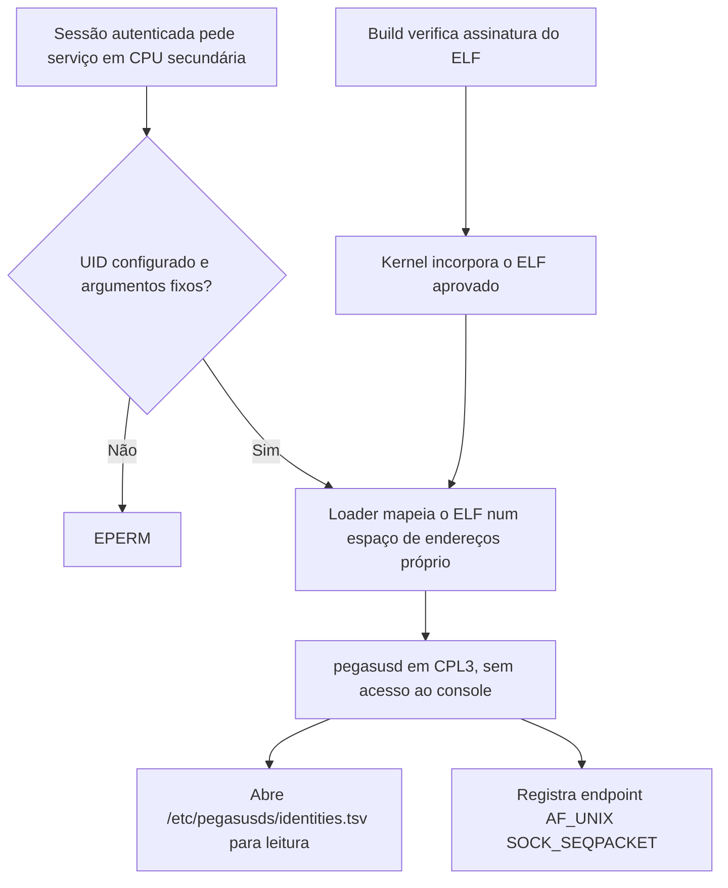
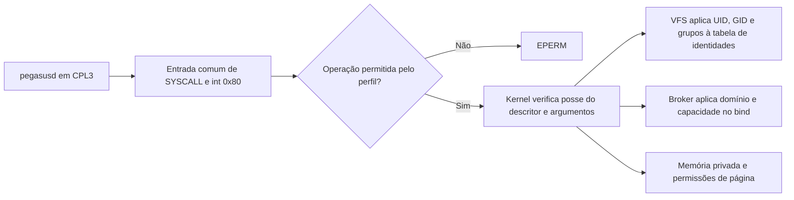
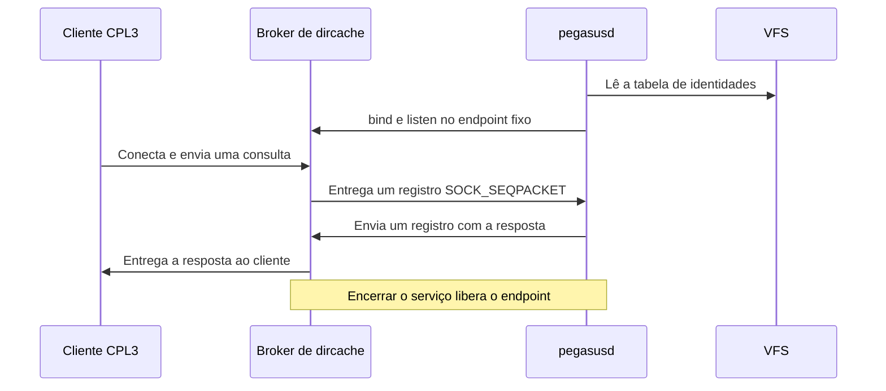

# Pegasus DS no perfil de serviço do CarlIO OS

O perfil executa o modo `--dircache` de um `pegasusd` estático. O build verifica
a assinatura Ed25519 antes de incorporar o ELF na imagem do kernel. A conta
configurada por `CARLIO_DIRCACHE_SERVICE_UID` precisa ter UID diferente de zero.
Ela inicia e encerra o serviço pela sessão autenticada do console.

## Lançamento em CPL3



## Limites do processo



O perfil veda criação de processos, troca de executável, alteração de
credenciais, sockets de rede, conexões iniciadas pelo daemon e mapeamentos
executáveis criados em tempo de execução. O único arquivo que o daemon
pode abrir é a tabela configurada. A escrita exige um descritor do broker ou uma das saídas nulas privadas.
Os três descritores padrão são nulos para satisfazer a inicialização do Rust
sem conectar o daemon à entrada ou à saída do console.
O escalonador e as cotas comuns de memória são compartilhados com o restante
do kernel.

## Consulta local de identidade




## Build e operação

No repositório do Pegasus DS, compile a variante estática GNU para o
modo dircache. Use o ELF `ET_EXEC` produzido por esta configuração.

```sh
export RUSTFLAGS='-C target-feature=+crt-static -C relocation-model=static -C link-arg=-no-pie -C strip=symbols'
cargo +stable build --locked --release -p pegasusd --features dircache
```

Gere a assinatura Ed25519 destacada com a chave da implantação e passe
os caminhos absolutos do ELF, da assinatura e da chave pública na build
do CarlIO OS. Configure o UID da conta que lerá a tabela.

```sh
export CARLIO_DIRCACHE=1 CARLIO_DIRCACHE_SERVICE_UID=1000
export CARLIO_DIRCACHE_EXECUTABLE="$daemon"
export CARLIO_DIRCACHE_SIGNATURE="$assinatura"
export CARLIO_DIRCACHE_PUBLIC_KEY="$chave_publica"
./scripts/build-iso.sh
```

Entre no console com a conta provisionada e inicie o serviço. Use o
PID informado pelo supervisor para a parada.

```text
servico iniciar /usr/sbin/pegasusd --dircache /etc/pegasusds/identities.tsv
servico parar PID
```

[Resultados da validação em VM](../reports/validacao-dircache.md)
